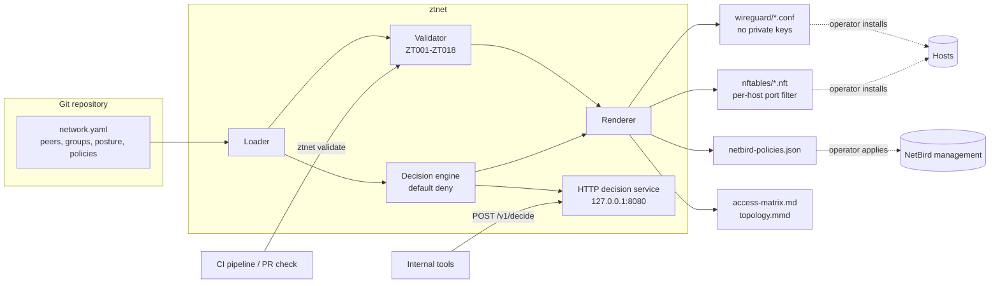

# zero-trust-devops-network

Policy-as-code for zero-trust DevOps networking on WireGuard and NetBird. One YAML file
describes peers, groups, device posture and allow rules for a platform team (engineers,
bastions, CI runners, Kubernetes clusters, databases, observability, VPC routing peers).
`ztnet` validates it against 18 zero-trust rules, answers "can A reach B on this port?",
and renders per-host WireGuard configs, nftables port filters, NetBird-shaped policy JSON,
an access matrix and a topology diagram. A small HTTP decision service exposes the same
engine to CI pipelines and internal tooling.

Everything is default deny. Private keys are never generated, stored or rendered.

## Architecture



More detail, including the request flow, is in [docs/architecture.md](docs/architecture.md).
Every validation code is listed in [docs/policy-reference.md](docs/policy-reference.md).

## What it enforces

- Default deny, private/CGNAT overlay ranges, unique in-range peer addresses.
- No `All -> All`, no `protocol: all` with the `All` group, no SSH/RDP/etcd/Kubernetes API/database ports open to `All`.
- Sensitive groups (prod clusters, prod databases) require explicit ports and a device posture check.
- Posture checks on the source device: minimum client version, OS allow-list, disk encryption.
- Time-boxed access via `expires`; expired policies fail validation and stop granting access.
- Routing peers only, no default route, no routes overlapping the overlay.
- Any `private_key` in the file is an error, and the value is never printed.

## Repository layout

```
src/ztnet/        loader, validator, decision engine, renderer, HTTP service, CLI
examples/         devops-network.yaml (clean) and insecure-network.yaml (rejected on purpose)
tests/            66 pytest tests (loader, rules, decisions, rendering, CLI, HTTP API)
docs/             architecture and policy reference
scripts/          validate-all.sh local quality gate
Dockerfile        image for the decision service (not built or published here)
```

## Setup

Requires Python 3.11+ and [uv](https://docs.astral.sh/uv/).

```bash
git clone https://github.com/shubhamkhedkar/zero-trust-devops-network.git
cd zero-trust-devops-network
uv sync --frozen           # installs the locked dependencies from uv.lock
make test                  # 66 tests
./scripts/validate-all.sh  # tests, lint, policy checks and a render dry-run
```

## Usage

```bash
# 1. Validate (exit 1 on errors, --strict also fails on warnings)
uv run ztnet validate examples/devops-network.yaml
uv run ztnet validate examples/insecure-network.yaml      # shows 14 errors

# 2. Ask an access question (exit 0 allowed, 3 denied)
uv run ztnet decide examples/devops-network.yaml --src bastion-01 --dst prod-db-01 --port 5432
uv run ztnet decide examples/devops-network.yaml --src oncall-laptop --dst bastion-01 --port 22
#   -> denied: engineer-device: client 0.27.4 < 0.30.0

# 3. Render artifacts (refuses when validation has errors)
uv run ztnet render examples/devops-network.yaml --out out/
#   out/wireguard/<peer>.conf  out/nftables/<peer>.nft  out/netbird-policies.json
#   out/access-matrix.md       out/topology.mmd

# 4. Run the decision service locally
uv run ztnet serve --policy examples/devops-network.yaml --port 8080
curl -s localhost:8080/healthz
curl -s -X POST localhost:8080/v1/decide \
  -d '{"src":"gha-runner-01","dst":"k8s-prod-api","protocol":"tcp","port":6443}'
```

| Endpoint | Description |
|---|---|
| `GET /healthz` | Liveness |
| `POST /v1/decide` | `{src, dst, protocol, port}` to allow/deny with the matching policy or posture failures |
| `POST /v1/validate` | Validate a candidate network document sent as JSON |
| `GET /v1/policy/report` | Validation report for the loaded policy |
| `GET /v1/policy/netbird` | NetBird-shaped policy JSON |
| `GET /v1/matrix` | Markdown access matrix |

The service binds to `127.0.0.1` by default and is read-only. Put it behind your own
authentication before exposing it beyond localhost.

## Using it in a pipeline

Run `uv run ztnet validate network.yaml --strict` as a required check on pull requests that
change the policy file, and attach `access-matrix.md` from `ztnet render` to the review so
reviewers see the effective reachability change. No workflow is included and GitHub Actions
is disabled on this repository.

## Rolling the output out (operator steps, run later by you)

These steps change real hosts and are deliberately not automated here.

1. On each host: `umask 077; wg genkey | tee /etc/wireguard/wg0.key | wg pubkey`, then put the
   public key into the peer's `public_key` field and re-run `ztnet validate` and `ztnet render`.
2. Copy `out/wireguard/<peer>.conf` to `/etc/wireguard/wg0.conf` and `out/nftables/<peer>.nft`
   to `/etc/ztnet/<peer>.nft` on that host, review both, then `wg-quick up wg0`.
3. For NetBird, map group and posture-check names in `netbird-policies.json` to the IDs in
   your NetBird account and apply them through the dashboard or management API after review.

## Limitations

- WireGuard and nftables output is generated as text and checked by unit tests; it has not been
  loaded by `wg-quick` or `nft` here, and no interface or firewall rule was created.
- `netbird-policies.json` follows the shape of NetBird's public policy API but uses group
  names instead of IDs and was not submitted to a NetBird instance.
- The nftables template assumes the WireGuard interface is `wg0` and IPv4/IPv6 host addresses.
- Posture data (client version, OS, disk encryption) comes from the YAML file, not from live
  device attestation.
- The example break-glass policy expires on 2027-06-30; after that date `validate` reports
  ZT011 until the policy is removed or renewed, which is the intended behaviour.
- The Docker image is defined but was not built.

## Cleanup

Nothing here creates resources. Delete `out/` and `.venv/` (`make clean`). If you rolled
configs out yourself: `wg-quick down wg0`, `nft delete table inet ztnet`, and remove
`/etc/wireguard/wg0.*` and `/etc/ztnet/`.

## References and attribution

- Inspired by [NetBird](https://github.com/netbirdio/netbird) by NetBird GmbH, whose
  group-based access policies, posture checks and routing peers informed the policy model.
  No NetBird code is included; see its repository for its licence terms.
- [WireGuard](https://www.wireguard.com/) is a registered trademark of Jason A. Donenfeld.
  This project only emits configuration in the documented `wg-quick` format.
- [nftables](https://wiki.nftables.org/) rule syntax is from the netfilter project documentation.

## License

MIT, see [LICENSE](LICENSE).
