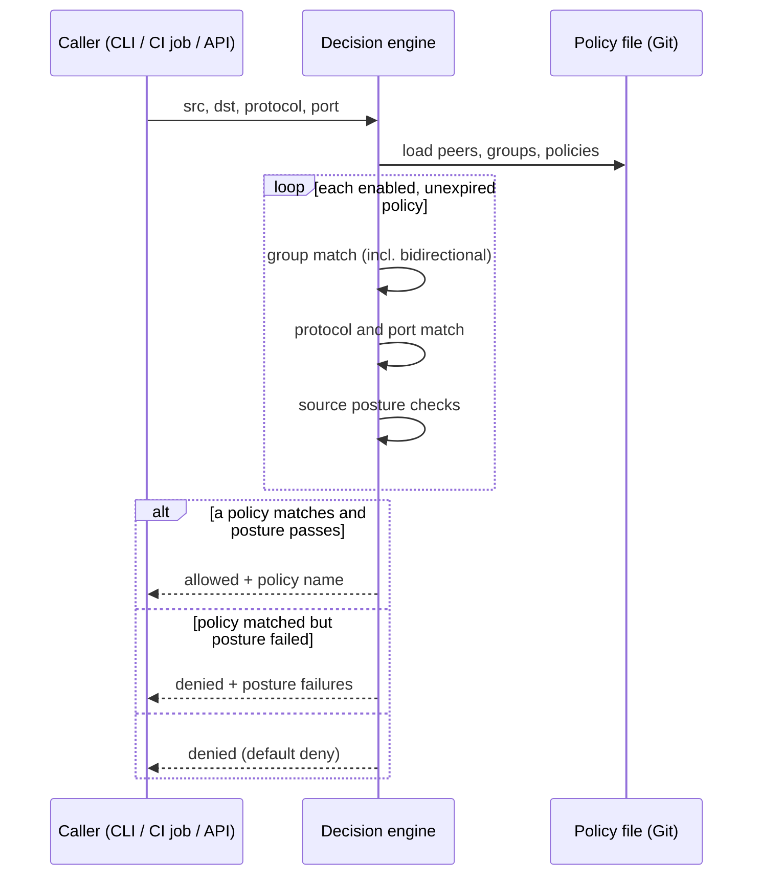
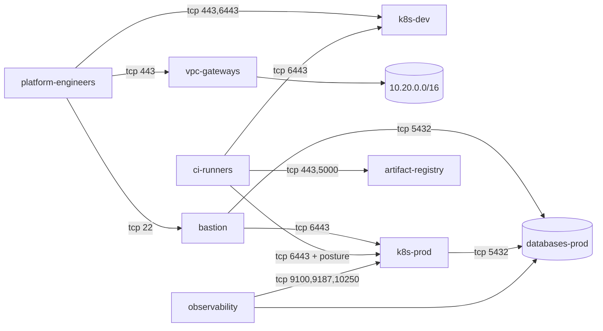

# Architecture

## Layers

1. **Identity and transport (WireGuard).** Every peer has a key pair generated on the host.
   A peer only accepts packets from public keys listed in its `[Peer]` sections, and
   `AllowedIPs` pins each key to one overlay address (plus routed subnets for routing peers).
   ztnet lists a peer only when some policy lets traffic flow in either direction, so
   unrelated peers cannot even complete a handshake.
2. **Authorisation (nftables).** WireGuard has no notion of ports. The generated
   `table inet ztnet` on each host accepts only the source address, protocol and ports a
   policy grants, then drops everything else arriving on `wg0`.
3. **Device posture.** Policies can require a minimum client version, an OS allow-list and
   disk encryption on the source device. A failing device loses access without any policy edit.
4. **Control plane (NetBird, optional).** `netbird-policies.json` mirrors the policy objects of
   NetBird's management API (groups, rules, posture checks), so the same definition can be
   reviewed in Git and then applied through NetBird by an operator. ztnet never calls that API.

## Request flow for `ztnet decide`

## Example topology

`ztnet render` writes `topology.mmd`; the example network renders to roughly:

